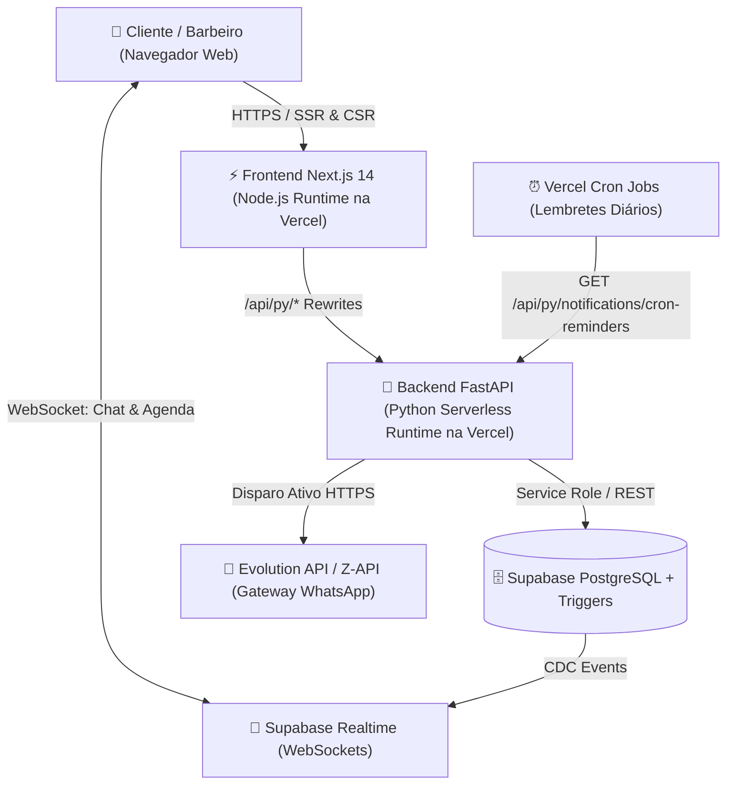

# 📐 Arquitetura do Sistema — Barbearia MVP

Este documento descreve a arquitetura de engenharia de software adotada para o sistema web da barbearia, combinando **Next.js (Node.js)** e **FastAPI (Python)** em uma única implantação Serverless na **Vercel**, respaldada pelo **Supabase** e gateway de **WhatsApp**.

---

## 1. Visão Geral da Infraestrutura

---

## 2. Divisão de Responsabilidades (Node.js vs Python)

| Camada | Tecnologia | Responsabilidades Principais |
| :--- | :--- | :--- |
| **Apresentação & UI** | **Node.js / Next.js 14** (`src/`) | Renderização da interface responsiva, catálogo de serviços, seletor interativo de calendário, cartão de fidelidade, chat em tempo real e validação de formulários. |
| **Regras de Negócio & Integrações** | **Python / FastAPI** (`api/`) | Cálculo de disponibilidade de horários (`availability_service.py`), motor de regras de fidelidade (`loyalty_service.py`), formatação de templates e disparo de mensagens WhatsApp (`whatsapp_service.py`) e execução de rotinas agendadas (Cron). |
| **Persistência & Tempo Real** | **Supabase** (`supabase/`) | Armazenamento relacional em PostgreSQL, integridade referencial, *Triggers* PL/pgSQL para pontuação automática de fidelidade, *Row Level Security (RLS)* e *Supabase Realtime* para mensagens instantâneas do chat. |

---

## 3. Fluxos Críticos do Sistema

### 3.1 Fluxo de Agendamento + Notificação WhatsApp
1. O cliente escolhe um serviço em `ServiceList`, seleciona o barbeiro e a data em `AvailabilityCalendar`.
2. O frontend consulta `GET /api/py/availability?barber_id=...&target_date=...`.
3. O serviço Python consulta os agendamentos ativos no Supabase, remove o horário de almoço do barbeiro e retorna os slots de 30 em 30 minutos.
4. Ao confirmar o horário, `POST /api/py/appointments` grava o agendamento e aciona imediatamente `send_whatsapp_message`, enviando o comprovante formatado para o WhatsApp do cliente.

### 3.2 Fluxo de Fidelidade Automatizado
1. Ao cadastrar um novo cliente em `public.profiles`, a trigger `trg_create_loyalty_card` cria automaticamente seu cartão em `public.loyalty_cards`.
2. Sempre que um agendamento muda para o status `completed`, a trigger `trg_credit_loyalty_points` soma os pontos do serviço realizado, incrementa o contador de selos (1 a 10), recalcula o nível (*Bronze, Prata, Ouro, VIP*) e registra o lançamento em `public.loyalty_transactions`.

