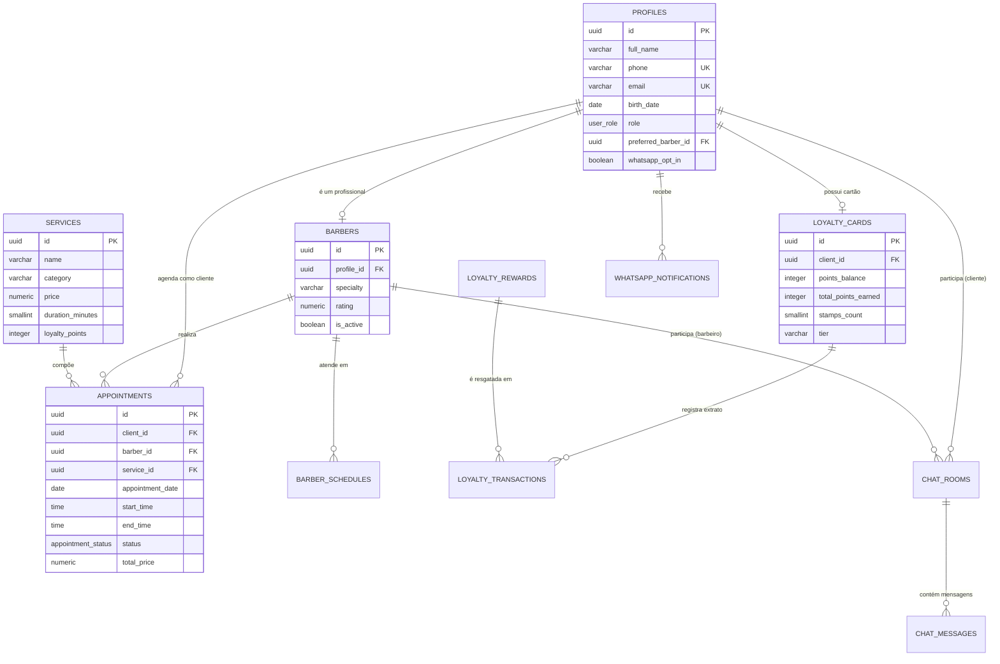

# 🗄️ Modelagem do Banco de Dados (Supabase / PostgreSQL)

Os scripts de criação de tabelas estão organizados no diretório `supabase/`:
- `supabase/migrations/001_initial_schema.sql`: Tabelas, relacionamentos, índices, funções e *triggers*.
- `supabase/migrations/002_rls_policies.sql`: Políticas de segurança *Row Level Security (RLS)* e configuração do *Supabase Realtime*.
- `supabase/seed.sql`: Dados iniciais de barbeiros, horários de expediente, serviços e recompensas.

---

## 1. Diagrama Entidade-Relacionamento (ERD)

---

## 2. Descrição das Tabelas

| Tabela | Finalidade |
| :--- | :--- |
| `public.profiles` | Cadastro básico de clientes, barbeiros e administradores (nome, telefone WhatsApp único, data de nascimento, barbeiro preferido e opt-in). |
| `public.barbers` | Dados profissionais de cada barbeiro (especialidade, avaliação, comissão e status ativo). |
| `public.barber_schedules` | Grade de expediente por dia da semana (`0` a `6`), horário de início/fim, intervalo de almoço e duração padrão do slot. |
| `public.services` | Catálogo de serviços da barbearia com preço, duração em minutos e quantidade de pontos de fidelidade gerados. |
| `public.appointments` | Agendamentos realizados pelos clientes, vinculando cliente, barbeiro, serviço, data, horário e status (`pending`, `confirmed`, `completed`, `cancelled`, `no_show`). |
| `public.loyalty_cards` | Saldo de pontos, contagem de selos (0 a 10) e categoria atual (`Bronze`, `Prata`, `Ouro`, `VIP`) do cliente. |
| `public.loyalty_rewards` | Catálogo de recompensas resgatáveis com pontos acumulados. |
| `public.loyalty_transactions` | Histórico auditável de pontos ganhos (`earn`) e resgatados (`redeem`). |
| `public.chat_rooms` / `public.chat_messages` | Salas de bate-papo e mensagens em tempo real entre barbeiro e cliente. |
| `public.whatsapp_notifications` | Log de auditoria e fila de envios de mensagens via WhatsApp. |

