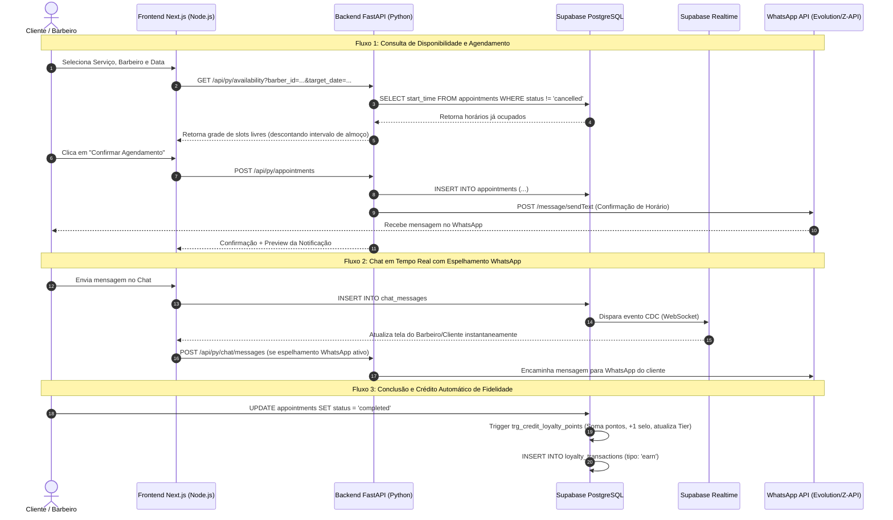
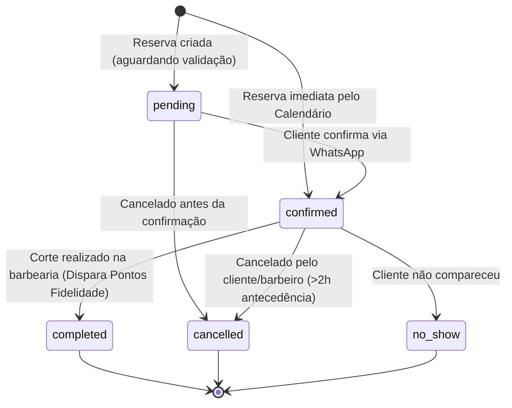
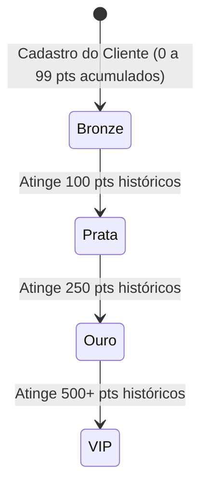
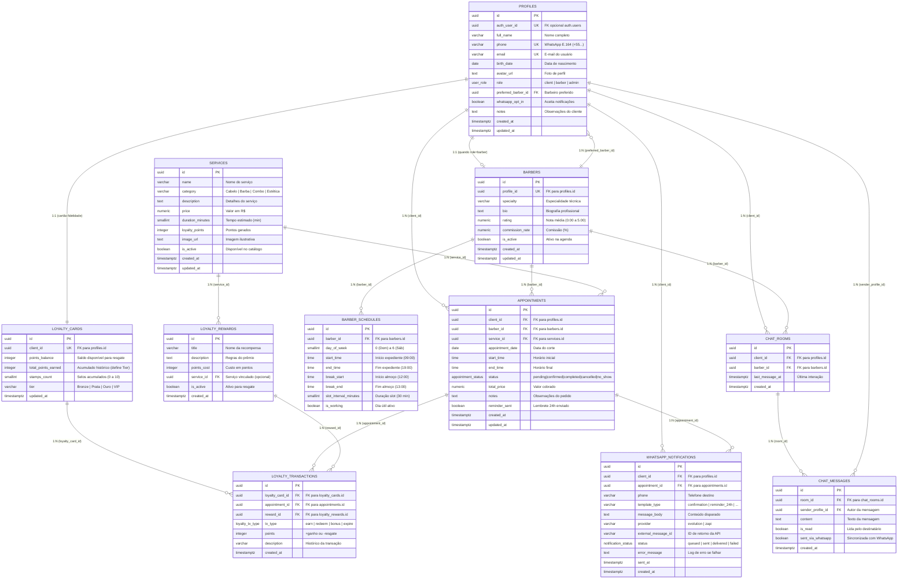

# 📊 Fluxogramas do Sistema e Diagrama Completo do Banco de Dados

Este documento consolida os fluxogramas operacionais, diagramas de sequência, máquina de estados e o Diagrama Entidade-Relacionamento (DER) completo do **Sistema Web para Barbearia (Barbearia MVP)**.

---

## 1. Fluxograma Geral de Operação (Jornada Ponta a Ponta)

O fluxograma abaixo representa o caminho completo do cliente desde o acesso à plataforma até o pós-atendimento com pontuação de fidelidade e notificações via WhatsApp:

```mermaid
flowchart TD
    Start(["👤 Cliente acessa o Sistema Web"]) --> CheckCadastro{"Possui cadastro?"}

    CheckCadastro -- "Não" --> FormCadastro["📝 6. Cadastro Básico do Cliente\n(Nome, WhatsApp, E-mail, Nascimento, Barbeiro Preferido)"]
    FormCadastro --> TriggerCard["⚡ Trigger SQL: trg_create_loyalty_card\nCria Cartão de Fidelidade (Nível Bronze, 0 pts)"]
    TriggerCard --> Catalogo

    CheckCadastro -- "Sim" --> Catalogo["✂️ 1. Lista de Serviços da Barbearia\nFiltra por Cabelo, Barba, Combo ou Estética"]
    Catalogo --> SelectService["Seleciona Serviço\n(Ex: Combo VIP - R$ 95 - 60 min - +40 pts)"]

    SelectService --> Calendario["📅 2. Calendário de Disponibilidade\nEscolhe Barbeiro e Data"]
    Calendario --> CalcSlots["🐍 API Python (/api/py/availability)\nConsulta Supabase + Desconta Almoço e Ocupados"]
    CalcSlots --> ChooseSlot["Cliente seleciona horário livre (Ex: 14:00)"]

    ChooseSlot --> ConfirmBook["✅ Confirma Agendamento\nGrava em public.appointments (status: confirmed)"]
    ConfirmBook --> WhatsAppConfirm["📲 3. Notificação WhatsApp (Evolution/Z-API)\nEnvia comprovante imediato para o celular do cliente"]

    WhatsAppConfirm --> CronJob["⏰ Lembrete Automático 24h Antes\nVercel Cron (/api/py/notifications/cron-reminders)"]
    WhatsAppConfirm --> Chat["💬 4. Chat Barbeiro & Cliente\nDúvidas em tempo real (Supabase Realtime + Ponte WhatsApp)"]

    CronJob --> Atendimento["💈 Atendimento Realizado na Barbearia"]
    Chat --> Atendimento

    Atendimento --> StatusComplete["Barbeiro finaliza atendimento\n(status muda para 'completed')"]
    StatusComplete --> TriggerPoints["⚡ Trigger SQL: trg_credit_loyalty_points\nSoma pontos do serviço + 1 selo no Cartão Fidelidade"]

    TriggerPoints --> CheckTier{"5. Plano de Fidelidade\nVerifica Saldo & Nível"}
    CheckTier -- "Saldo >= Custo Prêmio" --> Redeem["🎁 Cliente resgata Recompensa\n(Ex: Barba Terapia ou Corte 100% OFF)"]
    CheckTier -- "Acumulando" --> End(["🔄 Próximo Agendamento"])
    Redeem --> End
```

---

## 2. Diagrama de Sequência (Arquitetura Node.js + Python + Supabase + WhatsApp)

---

## 3. Diagramas de Estado (Agendamento e Fidelidade)

### 3.1 Ciclo de Vida do Agendamento (`appointment_status`)

### 3.2 Progressão de Níveis do Plano de Fidelidade (`tier`)

---

## 4. Diagrama Entidade-Relacionamento Completo (Banco de Dados Supabase)

O banco de dados no Supabase é composto por **11 tabelas** no schema `public`, conectadas por chaves estrangeiras (`FK`) e protegidas por *Row Level Security (RLS)*:

---

## 5. Resumo das Automações Internas do Banco (Triggers PL/pgSQL)

| Trigger | Tabela Alvo | Evento | Função Executada | Regra de Negócio |
| :--- | :--- | :--- | :--- | :--- |
| `trg_profiles_updated_at` | `profiles` | `BEFORE UPDATE` | `handle_updated_at()` | Atualiza `updated_at = NOW()` automaticamente. |
| `trg_barbers_updated_at` | `barbers` | `BEFORE UPDATE` | `handle_updated_at()` | Atualiza `updated_at = NOW()` automaticamente. |
| `trg_services_updated_at` | `services` | `BEFORE UPDATE` | `handle_updated_at()` | Atualiza `updated_at = NOW()` automaticamente. |
| `trg_appointments_updated_at` | `appointments` | `BEFORE UPDATE` | `handle_updated_at()` | Atualiza `updated_at = NOW()` automaticamente. |
| `trg_create_loyalty_card` | `profiles` | `AFTER INSERT` | `create_loyalty_card_for_new_client()` | Cria imediatamente um registro em `loyalty_cards` com saldo `0` e tier `Bronze` para todo novo cliente. |
| `trg_credit_loyalty_points` | `appointments` | `AFTER UPDATE` | `credit_loyalty_points_on_completion()` | Quando `status` passa para `'completed'`, soma `services.loyalty_points` ao cartão do cliente, avança `stamps_count` (1 a 10), recalcula o `tier` e grava o extrato em `loyalty_transactions`. |

